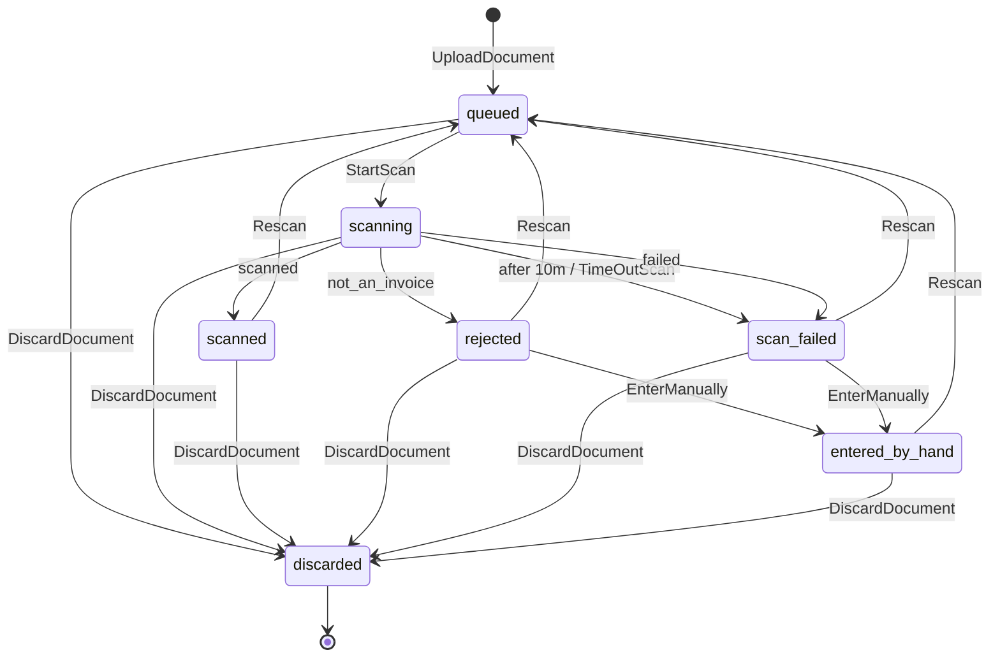
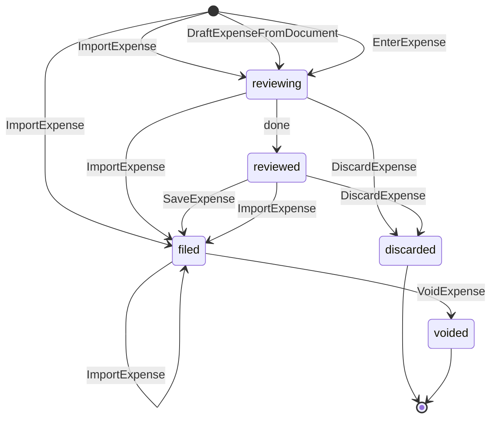
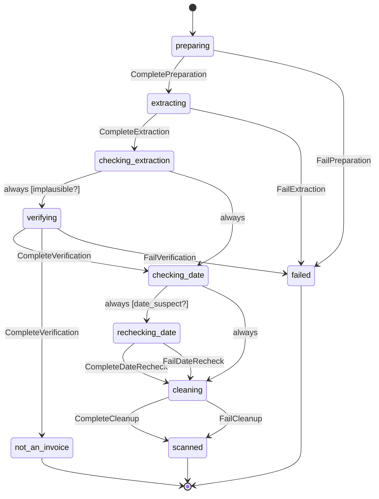
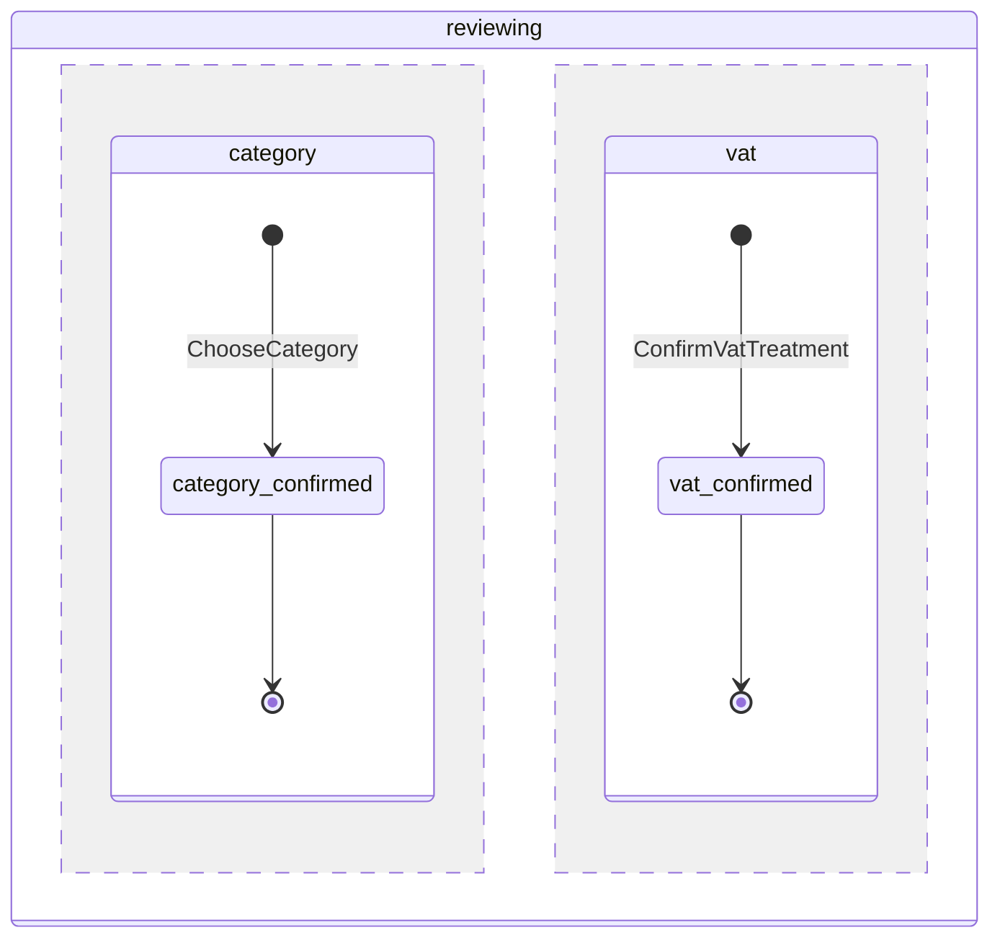
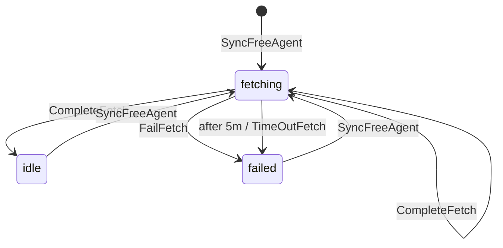

# Sourced Expenses

A [Sidereal](https://github.com/ismasan/sidereal) + [Sourced](https://github.com/ismasan/sourced) app that tracks expenses, after [this write-up](https://gist.github.com/julik/405662cc3106fe73ae2e46073f483b62). Uploaded receipts and invoices are scanned by an LLM (OpenAI by default) into draft expenses, listed on the home page as they go; expenses can also be entered by hand (`/expenses/new`), and other sources can draft them too.

https://github.com/user-attachments/assets/cfff0917-b71f-42b0-8cf4-f792b5111e46

## State machines

Two machines: one reads documents, the other is the expense, wherever it came from.

`Expenses::Document` (`system/expenses/document.rb`) is one machine per uploaded document, keyed by the MD5 of its bytes, so re-uploading the same file is a no-op. Once read, entering `scanned` drafts its expense (`Expense::DraftExpenseFromDocument`) with what it read, under the document's own id; one that couldn't be read, a person can draft by hand (`EnterManually`), empty. A rescan drafts again, which replaces the expense's draft while it's in review, and changes nothing once it's filed.

<!-- mermaid Expenses::Document -->

<!-- /mermaid -->

`Expenses::Expense` (`system/expenses/expense.rb`) is one machine per expense, wherever it came from. Its events say what the expense is: `ExpenseDrafted` (tentative figures, a scan's reading, for a person to check), `ExpenseRedrafted` (new tentative figures: its document read again), `ExpenseEntered` (a person's own figures), `ExpenseFiled`. Where it came from is a fact of its own, `DocumentAttached`. Each source starts it with its own command, under an id of its choosing (`Types::ExpenseID`):

| Command | From | Appends |
| --- | --- | --- |
| `DraftExpenseFromDocument` | a document once read (its id is the document's); again for the same document while in review, after a rescan | `ExpenseDrafted` and `DocumentAttached`; after a rescan, `ExpenseRedrafted` |
| `EnterExpense` | the new expense form (the UUID it was rendered with) | `ExpenseEntered` |
| `ImportExpense` | another system's expense (`freeagent-<its id there>`), trusted as its books have it; again when changed there | `ExpenseImported`, `CategoryChosen`, `VatTreatmentConfirmed` and `ExpenseFiled` (just `ExpenseImported`, in review with suggestions, for one without a category, VAT treatment or description); once changed, `ImportedExpenseChanged`, and filed again, confirming what changed: the source wins over a correction here |

The same command again changes nothing, so a source can safely send it twice.

<!-- mermaid Expenses::Expense -->

<!-- /mermaid -->

`Document::Scanning` (`system/expenses/document/scanning.rb`) is the OCR pipeline. Each LLM step waits for the `Expenses::Scanner` worker's `Complete…` / `Fail…`; the `checking_*` states are guarded decisions.

An upload or rescan waits in `queued` until the scan queue (a `WorkQueue` queue named `scans`) gives its scan a slot and appends `StartScan`, the command the document enqueued it with, so at most 3 documents (the queue's capacity) are in `scanning` at once, each making its model calls in turn. The scan's timeout starts with the scan, not the wait, and leaving `scanning` (or `queued`, discarded before its turn) frees the slot.

<!-- mermaid Expenses::Document scanning -->

<!-- /mermaid -->

`reviewing` has two steps, in either order: choosing the category (suggested by `Expenses::Categorizer`) and confirming the VAT treatment (suggested by rule from the scanned figures against `FILING_COUNTRY`, never by the model). Once both are done the expense is `reviewed`, and only then can it be filed. A new draft (a rescan's) keeps it where it is, so a step already done stays done.

<!-- mermaid Expenses::Expense reviewing -->

<!-- /mermaid -->

`bin/readme-diagrams` regenerates these from the code; the pre-commit hook runs it (enable with `git config core.hooksPath .githooks`).

`Integrations::FreeAgentImport` (`system/integrations/free_agent_import.rb`, its FreeAgent client and mapping in `system/integrations/free_agent/`) imports a FreeAgent account's expenses, a run at a time. Entering `fetching` reads a page of the expenses changed there since the last run finished, dispatches an `ImportExpense` for each (`Integrations::FreeAgent::ExpenseMapping`) and `CompleteFetch` for itself, all in one reaction in its own consumer group. Where the next run starts moves only when one finishes. Another source would be another machine like it, sending `ImportExpense`.

<!-- mermaid Integrations::FreeAgentImport -->

<!-- /mermaid -->

## Reactors and read models

Each is its own consumer group, so slow work never blocks the machine.

| Class | Does |
| --- | --- |
| `WorkQueue` | Capped work queues (`system/work_queue.rb`), one per `queue_name`, each with the capacity its latest `Enqueue` gave. A caller names its queue with `WorkQueue.define` and dispatches what it builds: `Document::ScanQueue = WorkQueue.define('scans', capacity: 3)`, enqueued with `ScanQueue.enqueue(StartScan, document_id:)` (`.with_capacity(n)` overrides the capacity), and each document holds its slot through every step of its scan. It records `Enqueued`, `Started`, `Released` and `Dropped`, and appends each item's start message (a document's `StartScan`) in the same commit as its `Started`. A plain reactor (a decider may only append to its own partition), which snapshots each queue's state every 100 history messages so a claim never reads its whole history. The bar along the bottom of every page shows the scan queue from the same snapshot and history (`ScanQueue.status`), following its events. |
| `Expenses::Scanner` | Runs each scan step against the LLM (`Expenses::ScanSteps`, prompts in `Expenses::Prompts`). Shrinks images over 500 KB with ImageMagick. |
| `Expenses::Categorizer` | Suggests a category for each draft or hand entry with a description, from the baseline (`Expenses::CATEGORIES`) and every other category expenses have had (`Expenses::CategoryList`), via a [RubyLLM judgment](https://rubyllm.com/judgments/). A person's `ChooseCategory` always wins. |
| `Expenses::CurrencyConverter` | Converts filed totals to `REPORTING_CURRENCY` at the ECB rate for the expense's date ([Frankfurter](https://frankfurter.dev)). |
| `Expenses::DocumentList` | Read model for the home page's documents: being read, and those that couldn't be. |
| `Expenses::ExpenseList` | Read model for the expense lists, plus the FTS5 search index (`expenses_search`). |
| `Expenses::CategoryList` | Read model of every category an expense has had (suggested, chosen or imported: a source's own with its name there), offered beside the baseline wherever a category is chosen. |
| `Expenses::Ledger` | Read model for monthly totals and category breakdowns in the reporting currency. |

Resetting a group (`bin/sid sourced groups reset <group>`) reprocesses: e.g. `expenses.categorizer` retries failed categorizations, `expenses.currency_converter` reconverts after changing `REPORTING_CURRENCY`.

## Run

```sh
bundle install
bin/sid db migrations run
bin/dev   # http://localhost:9292
```

Requires ImageMagick (`brew install imagemagick`). `bin/dev` reloads on change if `watchexec` or `fswatch` is installed. The Sourced dashboard is at `/sourced`.

| Env var | Default | |
| --- | --- | --- |
| `LLM_PROVIDER` | `openai` | Scanning provider: any [RubyLLM](https://rubyllm.com) provider that reads PDFs and images |
| `LLM_MODEL` | `gpt-4.1` | Scanning model (an OpenAI one by default: name one for another provider) |
| `LLM_JUDGMENT_PROVIDER` | `openai` | Categorization provider: one that answers RubyLLM judgments (openai, azure, ollama, ollama_cloud, openrouter, typesafe) |
| `LLM_JUDGMENT_MODEL` | `gpt-6-luna` | Categorization model (an OpenAI one by default: name one for another provider) |
| `OPENAI_API_KEY`, `ANTHROPIC_API_KEY`, … | — | Each provider's credentials, named after its RubyLLM settings (env or `.env`) |
| `REPORTING_CURRENCY` | `GBP` | Currency totals are in |
| `FILING_COUNTRY` | `GB` | Decides VAT treatment |
| `SCAN_TIMEOUT` | `10m` | Scan gives up after this |
| `EXCHANGE_RATES_URL` | Frankfurter | Alternative Frankfurter instance |
| `SIDEREAL_SECRET` | `storage/secret.txt`, which the first boot creates | The master secret Sidereal derives the session cookie's key and the live-updates URL signer's from. Set it (64 bytes or more, `bin/sid secret` makes one) when `storage/` doesn't survive deploys or the app runs on several machines: the same in every process and across deploys. Changing it logs everyone out |
| `PORT`, `HOST`, `COUNT` | | Server port, host, worker processes |

## FreeAgent

Expenses created or changed on [FreeAgent](https://www.freeagent.com) are imported and filed as FreeAgent has them: their figures, FreeAgent's category (one of the baseline's where the names match, or else its own, such as "Use of home") and its VAT treatment, both confirmed. One changed there is filed again with the change, so correct an imported expense on FreeAgent: a correction made here lasts until its next change there. One FreeAgent sends without a category, VAT treatment or description lands in review instead. Mileage claims aren't imported.

1. Optionally, try it on a [sandbox account](https://signup.sandbox.freeagent.com/signup) first, completing its company setup.
2. Create an app in the [FreeAgent Developer Dashboard](https://dev.freeagent.com), with the redirect URI `http://localhost:9292/integrations/freeagent/callback` (or wherever the app runs; `FREEAGENT_REDIRECT_URI` overrides it).
3. Put its OAuth identifier and secret in `.env` as `FREEAGENT_CLIENT_ID` and `FREEAGENT_CLIENT_SECRET` (`FREEAGENT_SANDBOX=1` for a sandbox account), and restart the app.
4. Connect your account on the FreeAgent page (`/integrations/freeagent`). Its tokens are kept in the database, never in the event store.
5. Import: the page's button, or `bin/sid expenses import freeagent`, from cron or the like. The first import reads everything, unless `--since` says from when.

`bin/sid expenses import --categories freeagent` lists FreeAgent's categories and which of the baseline's each is. One that is a baseline category under another name goes in `Integrations::FreeAgent::ExpenseMapping::ALIASES`; the rest are their own.

## Docker

```sh
docker build -t sourced-expenses .
docker run --rm -p 9292:9292 --env-file .env -v sourced-expenses:/app/storage sourced-expenses
```

Migrations run on start. Leave values in `.env` unquoted.

## Test

```sh
bundle exec rspec   # the LLM and exchange rates are faked
```

## Command line

```sh
bin/sid --help                                    # everything
bin/sid console                                   # IRB with the app loaded
bin/sid commands list                             # commands the app handles
bin/sid commands dispatch <Command> --attr value  # send one
bin/sid sourced topology                          # commands, events, reactors and how they connect
bin/sid sourced messages list --tail              # follow the event store
bin/sid sourced groups list                       # consumer groups and their status
bin/sid db migrations add <name>                  # new Sequel migration
bin/sid expenses upload ~/receipts/*.pdf          # upload documents to scan
bin/sid expenses import [--since <date>] freeagent # import what changed on FreeAgent
bin/sid expenses list --state filed --json        # filter expenses
bin/sid expenses list --vat-status suggested      # by whose VAT treatment (or --category-status) it is
bin/sid expenses dispatch <Command>               # a command per JSON line on stdin
```

For example, confirming every suggested category:

```sh
bin/sid expenses list --state reviewing --category-status suggested --json |
  bin/sid expenses dispatch expenses.choose_category
```

## Layout

| Path | |
| --- | --- |
| `system/` | Messages, machines, reactors, read models (no web) |
| `web/app.rb`, `web/ui/` | Web app, pages and components. Each page or component has its stylesheet beside it (`top_nav.rb`, `top_nav.css`); `layout.css` has the shared rules. `web/app.rb` installs them, in the order of the cascade |
| `cli/` | The app's `bin/sid expenses …` commands |
| `config/components/` | Components (`db`, clients…) declared with `Sidereal.config` |
| `db/migrations/` | Sequel migrations, including Sourced's tables |
| `storage/` | SQLite database, uploads and `secret.txt`, the app's secret unless `SIDEREAL_SECRET` is set (not committed) |
| `.agents/skills/` | Skills for AI coding agents (`.claude/skills` links here) |

Classes in `system/` and `web/` are autoloaded by Zeitwerk.
