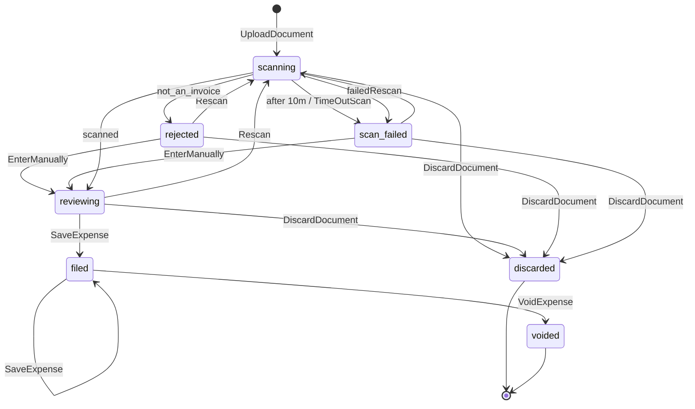
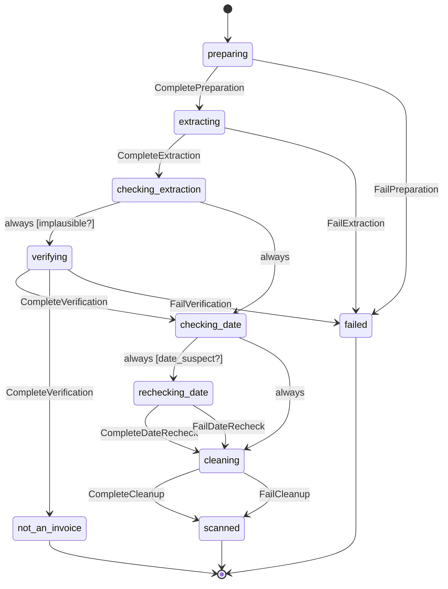
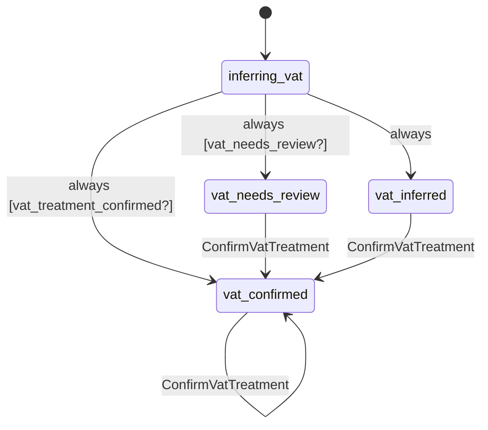

# Sourced Expenses

A [Sidereal](https://github.com/ismasan/sidereal) + [Sourced](https://github.com/ismasan/sourced) app that tracks expenses from scanned receipts and invoices, after [this write-up](https://gist.github.com/julik/405662cc3106fe73ae2e46073f483b62). Uploads are scanned with OpenAI and listed on the home page as they go.

https://github.com/user-attachments/assets/cfff0917-b71f-42b0-8cf4-f792b5111e46

## State machines

`Expenses::Expense` (`system/expenses/expense.rb`) is one machine per uploaded document, keyed by the MD5 of its bytes, so re-uploading the same file is a no-op.

<!-- mermaid Expenses::Expense -->

<!-- /mermaid -->

`Expense::Scanning` (`system/expenses/expense/scanning.rb`) is the OCR pipeline. Each LLM step waits for the `Expenses::Scanner` worker's `Complete…` / `Fail…`; the `checking_*` states are guarded decisions.

<!-- mermaid Expenses::Expense scanning -->

<!-- /mermaid -->

`Expense::Filed` (`system/expenses/expense/filed.rb`) holds the VAT treatment, inferred by rule (never by the model) against `FILING_COUNTRY`.

<!-- mermaid Expenses::Expense filed -->

<!-- /mermaid -->

`bin/readme-diagrams` regenerates these from the code; the pre-commit hook runs it (enable with `git config core.hooksPath .githooks`).

## Reactors and read models

Each is its own consumer group, so slow work never blocks the machine.

| Class | Does |
| --- | --- |
| `Expenses::Scanner` | Runs each scan step against OpenAI (`Expenses::ScanSteps`, prompts in `Expenses::Prompts`). Shrinks images over 500 KB with ImageMagick. |
| `Expenses::Categorizer` | Suggests a category from `Expenses::CATEGORIES` via a [RubyLLM judgment](https://rubyllm.com/judgments/). A person's `ChooseCategory` always wins. |
| `Expenses::CurrencyConverter` | Converts filed totals to `REPORTING_CURRENCY` at the ECB rate for the expense's date ([Frankfurter](https://frankfurter.dev)). |
| `Expenses::Submissions` | Read model for the home page, plus the FTS5 search index (`submissions_search`). |
| `Expenses::Ledger` | Read model for monthly totals and category breakdowns in the reporting currency. |

Resetting a group (`bin/sid sourced groups reset <group>`) reprocesses: e.g. `expenses.categorizer` retries failed categorizations, `expenses.currency_converter` reconverts after changing `REPORTING_CURRENCY`.

## Run

```sh
bundle install
bin/sid db migrations run
bin/dev   # http://localhost:9292
```

Requires ImageMagick (`brew install imagemagick`). `bin/dev` reloads on change if `watchexec` or `fswatch` is installed. The Sourced dashboard is at `/sourced`.

| Env var | Default | |
| --- | --- | --- |
| `OPENAI_API_KEY` | — | Required for scanning (env or `.env`) |
| `OPENAI_MODEL` | `gpt-4.1` | Scanning model |
| `OPENAI_JUDGMENT_MODEL` | `gpt-6-luna` | Categorization model |
| `REPORTING_CURRENCY` | `GBP` | Currency totals are in |
| `FILING_COUNTRY` | `GB` | Decides VAT treatment |
| `SCAN_TIMEOUT` | `10m` | Scan gives up after this |
| `EXCHANGE_RATES_URL` | Frankfurter | Alternative Frankfurter instance |
| `PORT`, `HOST`, `COUNT` | | Server port, host, worker processes |

## Docker

```sh
docker build -t sourced-expenses .
docker run --rm -p 9292:9292 --env-file .env -v sourced-expenses:/app/storage sourced-expenses
```

Migrations run on start. Leave values in `.env` unquoted.

## Test

```sh
bundle exec rspec   # OpenAI and exchange rates are faked
```

## Command line

```sh
bin/sid --help                                    # everything
bin/sid console                                   # IRB with the app loaded
bin/sid commands list                             # commands the app handles
bin/sid commands dispatch <Command> --attr value  # send one
bin/sid sourced topology                          # commands, events, reactors and how they connect
bin/sid sourced messages list --tail              # follow the event store
bin/sid sourced groups list                       # consumer groups and their status
bin/sid db migrations add <name>                  # new Sequel migration
bin/sid expenses upload ~/receipts/*.pdf          # upload documents to scan
bin/sid expenses list --state filed --json        # filter expenses
bin/sid expenses dispatch <Command>               # a command per JSON line on stdin
```

For example, confirming every suggested category:

```sh
bin/sid expenses list --state filed,vat_needs_review --category-status suggested --json |
  bin/sid expenses dispatch expenses.choose_category
```

## Layout

| Path | |
| --- | --- |
| `system/` | Messages, machines, reactors, read models (no web) |
| `web/app.rb`, `web/ui/` | Web app, pages and components |
| `cli/` | The app's `bin/sid expenses …` commands |
| `config/components/` | Components (`db`, clients…) declared with `Sidereal.config` |
| `db/migrations/` | Sequel migrations, including Sourced's tables |
| `storage/` | SQLite database and uploads (not committed) |
| `.agents/skills/` | Skills for AI coding agents (`.claude/skills` links here) |

Classes in `system/` and `web/` are autoloaded by Zeitwerk.
